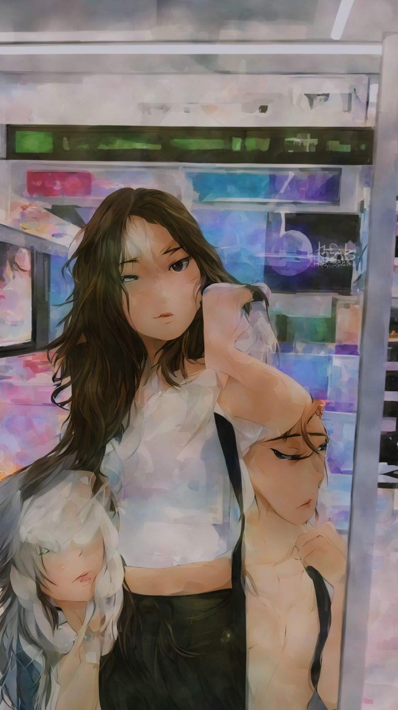
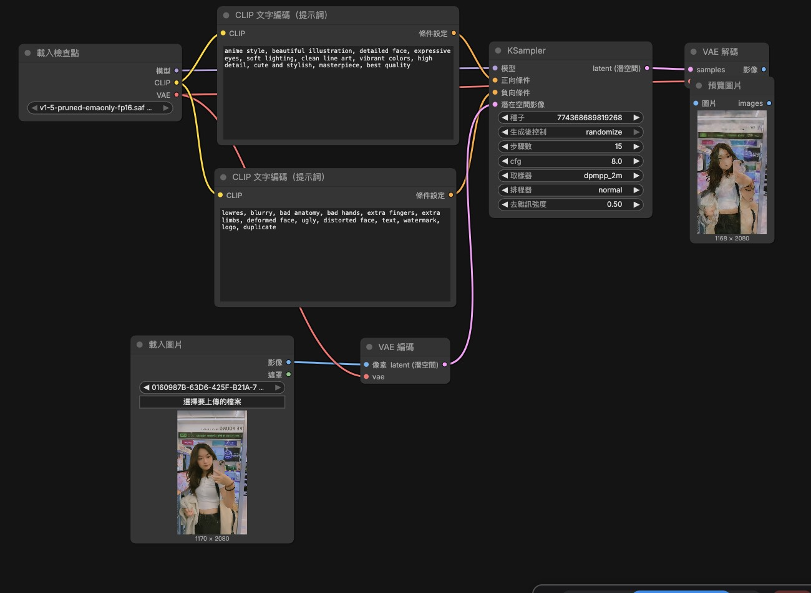

## 原圖

## 生成圖

## 完整工作流成圖

## 正提示詞
### anime style, beautiful illustration, detailed face, expressive eyes, soft lighting, clean line art, vibrant colors, high detail, cute and stylish, masterpiece, best quality
## 反提示詞
### lowres, blurry, bad anatomy, bad hands, extra fingers, extra limbs, deformed face, ugly, distorted face, text, watermark, logo, duplicate
## 心得
### 生成出的圖片很奇怪，可能是提示詞沒有打好的緣故，這個工具要運作的過程有點複雜。